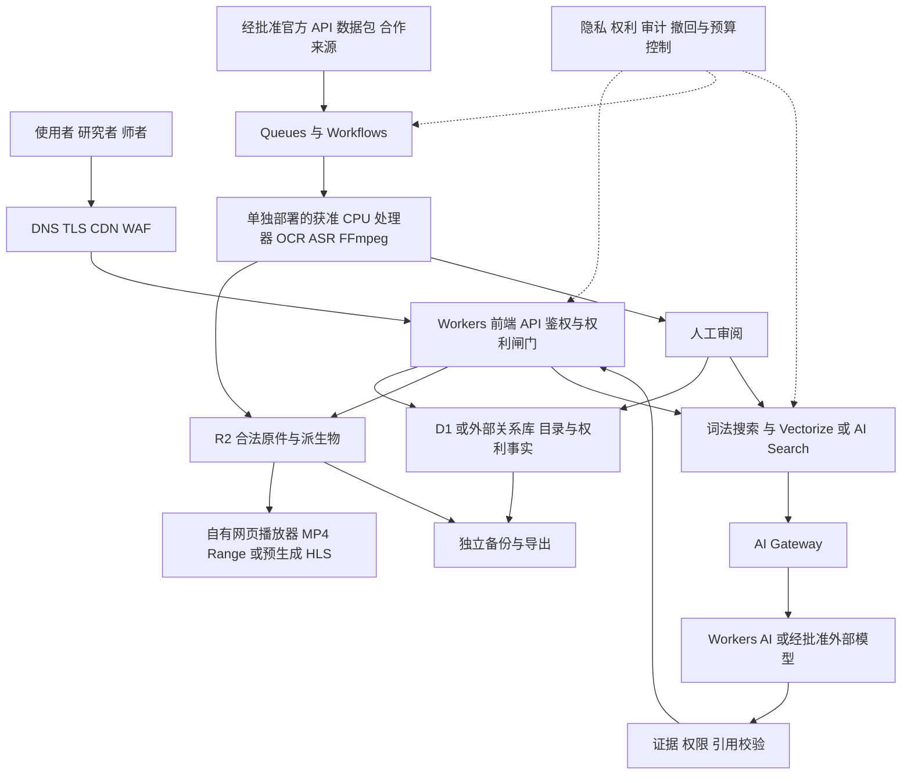

# Dharmagate 架构定义

版本 v0.1 · 设计提案 · 2026-10-25

配套：[产品定义](product-definition.zh-CN.md) · [架构定义](architecture-definition.zh-CN.md) · [UIUX 设计](uiux-design.zh-CN.md) · [完整 backlog](backlog.md)

## 01 架构定义与技术决策摘要

**架构目标：用 Cloudflare 建立可追溯、可控权利、可验证答案的全球佛学资料服务。** 核心资产是合法原件、版本化元数据与出处关系；搜索索引、模型和界面均应可替换。此文件面向工程、数据、安全、运维和技术采购团队，不把产品愿景写成已经实现的能力。

本版与《产品定义》和《UIUX 用户体验设计》同为 v0.1 设计提案。P0 先完成一条经核许可来源、10 至 30 部资料的文本闭环；影音为 P1，不使用 Cloudflare Stream。所有新付费服务、生产写入和资源授权都需适用审批。

| 决策 | 采用方向 |
| --- | --- |
| 资料与权利 | 联合目录加分权限内容库；权限在采集、派生、检索、生成、下载、撤回处共同执行。 |
| 应用与存储 | Workers 承担 API 与编排；R2 保存原件派生；D1 或外部关系库保存目录与权利事实。 |
| 智能服务 | 混合检索与证据 RAG 优先；托管 AI Search 与自管 Vectorize 路线择优，不重复建设。 |
| 无 Stream 影音 | R2 加自有播放器；FFmpeg OCR ASR 经适配器运行于已核准执行环境。 |
| 长期可迁移 | 原件、元数据、索引配置可导出；独立备份、恢复和撤回能力经演练确认。 |

Cloudflare 的产品能力、套餐、价格和地区条件按 2026 年 10 月 25 日官方资料核验。价格与容量是选型依据而非账户合同承诺；临上线需复核。中国大陆可达和当地合规是独立验证项目，不从全球网络自动推断。

## 02 可追溯的数据模型

以关系型目录保存事实和权限，以对象存储保存原件与派生物，以搜索索引提供查找能力。索引是可再生成的衍生物，不能成为唯一原始记录。采用内部稳定 UUID，同时保存各机构标识符；作品关系与术语映射保持显式、可审阅，不自动把相似标题认作同一作品。

| 实体 | 关键字段 | 设计要求 |
| --- | --- | --- |
| 作品 Work | 规范题名 异名 传统 作者 年代 | 年代可为区间或未知；归属存在争议时保留多观点。 |
| 表达与版本 | 语言 译者 校订者 版本号 底本 | 原文、译文与注疏分开；版本之间建立可解释关系。 |
| 数字资产 Asset | MIME 大小 SHA256 原站 存储键 | 原件不可覆盖；原扫描、OCR、校订文本均有独立 ID。 |
| 段落与片段 | 文本 边界 页码 章节 时间戳 | 可回到原页或播放器；引用保持稳定，不只给向量 ID。 |
| 人物与机构 | 名称 异名 角色 机构标识 | 身份由来源证明；不依据人脸或声音自动确认师者。 |
| 权利与访问 | 许可 权利人 地域 期限 用途 | unknown 默认不允许；撤回影响所有衍生物和缓存。 |
| 处理与审阅 | 任务版本 模型 审阅人 错误标记 | 记录 OCR 与 ASR 置信度，保留人工修订和审核轨迹。 |

### 建议的字段与接口约定

书目兼容 Dublin Core 与常见馆藏标识；有条件时保留 TEI XML、IIIF manifest 及源站规范结构。对外 API 返回 canonical_id、source_url、edition_id、language、script、locator、rights、updated_at 和 provenance。系统可以映射外部格式，但不宣称在未实施校验前已完整符合任一标准。

同一片段需要三组独立版本号：内容版本、权利版本、索引版本。文本更新后重建派生；权限收紧后立即停止内容访问和检索命中，随后清除向量、缓存、摘要及离线导出授权。下载包附带许可和出处 manifest，提供校验和与版本日期，使用户拿走资料后仍知道它来自哪里。

### 去重不得消灭文本历史

文件层用精确校验和去重，内容层用相似度找候选，作品层由规则与人工确认。保留不同扫描、异文、译者和刊本的关系；搜索可聚合展示，却仍允许研究者逐版本查看。对简繁转换、异体字归并、巴利转写和藏文分词同时保存原串及规范化字段。

## 03 下载处理与发布管线

每个来源先经过权利闸门，才允许获得原件；每个派生任务再检查它自己的用途许可。推荐以 Queue 分发短任务、Workflow 管理长流程与重试；大文件与长时影音处理交给适合的容器或外部批处理，不在一次边缘请求里完成整条链。

| 阶段 | 处理结果 | 失败时的行为 |
| --- | --- | --- |
| 发现与登记 | 来源清单 上游 ID 许可证据 | 授权不清留在目录层，进入人工待办。 |
| 获取与隔离 | 原始对象 校验和 下载凭证 | 限速重试；类型异常、恶意内容进入隔离区。 |
| 解析与质量 | 正文结构 OCR ASR 字幕时间轴 | 乱码或低置信度不进入正式问答库。 |
| 版本与关联 | 规范题名 语种 译本 版本关系 | 模糊匹配只生成候选，不静默合并作品。 |
| 派生与索引 | 词法索引 向量 缩略图 可下载包 | 按许可执行；索引可重建，原件不可修改。 |
| 审阅与发布 | 审核签名 引文定位 公开版本 | 来源或权利缺失则阻断发布。 |
| 同步与撤回 | 增量变更 删除与缓存清除记录 | 停止服务优先，彻底清理随后可核查完成。 |

### 工程上必须具备的控制

任务幂等键由来源 ID、资源 ID、内容版本与任务类型组成；消息重复投递不得重复收费或制造重复资产。保留检查点、死信队列和失败原因，人工可以单项重放。下载和 OCR、ASR、嵌入分别设每日额度，防止抓取异常带来无界成本。对上游删除或许可变化，先触发内容下线事件，再处理衍生物清理。

OCR 不能只看整页平均置信度。分别抽查典籍编号、专名、偈颂、页码和校勘符号；传统文字、竖排、手稿需要专门模型与校对。ASR 应按语种和录音环境评测，保存说话人标识为未验证或由人工确认，不推测身份、种族、宗教归属或心理状态。

### 第一期的安全边界

P0 只处理一条来源的 10 至 30 部代表资料，先完成端到端验证。后续批量范围经权利和预算批准再扩展。每批以权利信息完整率 100% 为发布条件；低质量材料可以作为带警示的目录存在，但不能冒充已校勘正文进入权威问答。

## 04 Cloudflare 参考架构

Cloudflare 承担全球接入与主要应用控制面；合法内容是资产，检索与模型是可替换的服务。建议把业务域拆成 public、catalog、ingest、search、ai、review 和 admin，避免一个 Worker 同时拥有全部下载、管理与删除权限。

图 1 参考架构  箭头表示数据或调用关系  权利检查横跨采集 检索 生成 下载和删除

### 在线请求路径

浏览器通过 DNS、TLS、缓存与 WAF 到达静态站点和 Workers API。目录查询先查结构化字段及词法索引；语义检索再访问 Vectorize 或托管检索能力。模型请求经 AI Gateway 统一做限额、可观测与路由。返回前验证证据、权限和引用定位；下载则由服务签发短期授权地址，不公开暴露私有对象。

### 离线处理路径

经批准的来源进入采集队列，Workflows 协调获取、检测、提取、校对、索引和发布。R2 分开放置隔离原件、已批准内容与衍生物；目录及权利事实在 D1 或外部关系数据库中维护。需要 PostgreSQL 和更复杂事务时，通过 Hyperdrive 连接受管理数据库，而不是误把 Hyperdrive 当数据库。

业务日志、模型使用量和内容质量分别观测。私密修学记录不与公共语料共库索引，不进入默认日志或模型训练。部署、回滚、备份恢复和删除验证均用独立环境演练。中国大陆访问与当地合规另立项目验证，不从‘全球网络’推断大陆一定可用或已满足数据要求。

## 05 产品选择与能力边界

‘使用所有已有能力’应落实为：充分利用合适的 Cloudflare 能力，并解释未采用的原因。产品、套餐与可用地区会变化，下表是选择框架，不是采购承诺。托管 AI 检索与自建检索是可以替换或组合的路径，不应一开始维护两套重复成本。

| 档位 | 能力 | 使用位置与注意事项 |
| --- | --- | --- |
| 必选 | DNS TLS CDN WAF | 公开入口与应用保护；缓存不能越过用户与内容权限。 |
| 必选 | Workers 静态资源 | 前端、API、鉴权和请求编排；不执行长时重型批处理。 |
| 必选 | R2 Queues Workflows | 内容存储与异步管线；为重试、吞吐、对象大小和保留期设预算。 |
| 必选 | D1 或外部关系库 | 目录和权利事实；以真实规模、事务和地区需求选择。 |
| 必选 | AI Gateway 与观测 | 模型访问、限额、成本和错误追踪；默认避免记录敏感正文。 |
| 按需 | Workers AI Vectorize AI Search | 嵌入、推理与检索。先验证语种、权利过滤和引用保真度。 |
| 按需 | Images 与自有播放器 | Images 可用于授权图像；影音采用 R2 加自有播放器，转码算力另配。本方案不使用 Stream。 |
| 按需 | Durable Objects KV | 协作会话和轻量配置；KV 不承担强一致的权限事实源。 |
| 按需 | Access Turnstile Gateway | 后台访问、反滥用与团队出口保护；不把人机挑战当完整安全体系。 |
| 按需 | Containers Hyperdrive 浏览器渲染 | 重型适配器、外部数据库连接、获准的动态页处理。 |
| 暂缓 | Realtime 大规模直播 Agent 自主执行 | 先证明需求；不让智能体自由抓取、发布或改变授权。 |
| 暂缓 | 训练专用模型与全域数据平台 | 先积累评测与治理能力；训练不是获得知识可靠性的捷径。 |

不要假设 Cloudflare 原生产品已覆盖所有需求：多语言全文搜索、复杂知识图谱、专业古籍 OCR、档案级保存、长时音视频处理及严格数据驻留，可能需要外部组件或合作机构。保持开放接口和可导出的原件、元数据、索引配置，避免把长期文化资产锁在某一种模型或产品里。

产品边界的核验依据见 [C1][C3][C10] 至 [C19]。Browser Run 只用于获准动态页；图片处理应核单图限制，古籍超大扫描优先切片和缩略图。[C20][C21]

## 06 容量限制与选型验证

这些限制直接影响设计，不能只在采购时才发现。数值按 2026 年 10 月 25 日读取的官方资料；上线前再次确认套餐和当前限制。首期应制作小型容量实验，测量真实文本、向量、影音和权限过滤行为。

| 产品 | 当前重要边界 | 架构含义 |
| --- | --- | --- |
| Workers | 128 MB 内存；付费 HTTP CPU 默认 30 秒，最高 5 分钟。[C1] | 边缘服务专注鉴权和编排，不承担整部视频转码。 |
| AI Search | 付费单实例最多 100 万文件，混合索引 50 万；自定义元数据仅 5 字段。[C10] | 独立保存书目与权利事实。采用前验证细粒度权限，不把它当完整档案库。 |
| AI Search 文件 | OCR PDF 及文本上限 10 MiB；非 OCR PDF 与其他格式 4 MiB。[C10] | 大扫描册先由专用管线处理，按稳定段落和页码组织，不任意截断证据。 |
| Vectorize | 每索引最多 2000 万向量、1536 维；10 个元数据索引。[C11] | 选嵌入模型前核维度；维度或距离算法更换需新建索引并重建切换。 |
| D1 | 付费单库 10 GB，账户 1 TB；行最大 2 MB。[C12] | 存目录和作业元数据，不塞影音与整库 OCR；增长时分域或采用外部关系库。 |
| KV | 最终一致；跨区域变更可能 60 秒或更久。[C13] | 不作即时撤权的唯一真源；命中缓存后仍需权威访问判断。 |
| Queues | 至少一次投递，消息最大 128 KB。[C14][C23] | 消息传对象指针与任务 ID；幂等、去重、死信与重放必需。 |
| Workflows | 耐久编排不等于无限 CPU；完成记录有保留期限。[C15] | 长期审计另存；OCR 和转码运行在专用执行器。 |

AI Gateway 提供观测、缓存、限额和模型路由，不负责自动证明事实。Workers AI 的多语模型能力也不能代替对古汉语、巴利语、梵语和藏语的实测。Hyperdrive 只是外部 PostgreSQL 或 MySQL 的连接优化，不是数据库托管服务。[C16][C17][C18]

本版不假设 Cloudflare 提供任意 GPU 训练或档案级长期保存的完整交钥匙服务。专业 OCR、罕见语种 ASR、知识图谱和超长批处理保留可替换适配器；容器可选，但必须先确认产品限制、算力与预算。[C19]

## 07 无 Stream 影音工程设计

**R2 是对象存储，不是自动媒体加工平台。** 影音 P1 的首个版本使用 H.264 与 AAC 的 faststart MP4、独立音频、WebVTT 字幕和海报；达到弱网需求与规模门槛后，再增加 2 至 3 档预生成 HLS。DASH、DRM 与直播暂不纳入。转码、抽音轨、字幕和码率梯度由获准 CPU 执行器完成，Workflows 只负责协调。[C1][C3]

| 工作面 | 必须实现的细节 |
| --- | --- |
| 资产和发布 | 原件 私有待审 公开派生分离。键含 asset_id/version/profile/hash；对象不可变，manifest 最后发布，记录 ffprobe 与 FFmpeg 版本。 |
| 公开点播 | 使用自定义域和缓存规则；r2.dev 仅开发，不作为正式播放域。巨型 MP4 的可缓存性受套餐上限影响，短 HLS 分片更稳妥。[C4][C5] |
| 私有点播 | Worker 验证 session 或短期签名的资产、版本、路径和到期时间；manifest、分片、字幕、海报均受同等授权。鉴权必须先于共享缓存。 |
| 简单下载 | 可使用短期 S3 presigned URL，但它是可重用 bearer token；只适用指定 R2 API 域名，不能直接当自定义域 CDN 签名。[C6] |
| HTTP 正确性 | 完整测试 GET HEAD 200 206 304 416、Content Range、长度、ETag 与 Range；If Range 由应用层策略处理，禁止部分 body 错返 200。[C7] |
| 缓存与跨域 | Cache API 不接受 put 206，且为本地数据中心缓存；完整分片 200 缓存更简单。CORS 只允许所需站点与头部，不能替代鉴权。[C8][C9] |
| 撤回与恢复 | 撤回后令牌拒绝、目录下架、公开派生封禁与缓存清除、字幕及向量删除；从原件与版本化配置可以重建派生。 |

Workers 单 isolate 内存为 128 MB；付费 HTTP CPU 默认 30 秒、可提高到 5 分钟，因此不能将长视频 FFmpeg 转码塞进请求。长连接不等于无限 CPU。CPU 环境尚未确认时，转码执行任务标为 Blocked，不能擅自新增付费服务。[C1]

签名链接、HLS 加密或隐藏对象地址都不是完整 DRM，不能承诺防录屏和防复制。浏览器与真实设备必须测试播放、seek、倍速、字幕、弱网和授权续期；‘页面打开了’不等于媒体验收完成。

## 08 搜索与证据型问答

### 先让人找到可靠材料 再让模型帮助理解

统一搜索需要四种入口：精确书目和典籍编号、全文关键词、概念与跨语义检索、影音时间片检索。搜索结果明确区分原典、译文、注疏、讲授、学术研究与 AI 生成解释。用户可按传统、语种、年代、版本、媒介、来源、权利和审阅状态过滤；同一段的多译本并列，而非模型融合成没有出处的新文本。

| 步骤 | 实现要求 |
| --- | --- |
| 理解问题 | 判断用户是在找书、比较译本、寻求解释还是个人实践；只在必要时追问传统和经验。 |
| 检索前鉴权 | 先按用户、地区、用途及来源权利建立可见范围，再进行检索；不把受限片段交给模型后再遮掩。 |
| 混合召回 | 典籍编号和关键词优先精确命中；结合语义向量，原文与规范化字段并行保留。 |
| 重排与证据束 | 选择相互独立的高质量来源；保留版本、段落、页码或时间点，不只返回摘要。 |
| 受约束生成 | 仅凭证据回答事实问题，区别引文、释义与推测；存在传统差异时列出，不擅自判定唯一正确。 |
| 引用校验 | 检查引用确实包含所述内容、链接可开、定位准确；证据不足则诚实说明并给出检索入口。 |
| 审计与反馈 | 保存非敏感的证据 ID 和模型版本；允许报告错引，能撤回有问题的答案。 |

### 防止看似有引用 实际无证据

答案中的每一项重要事实应有证据支持，引用卡片展开后直接看到原段与上下文。经文不得由模型凭记忆补全；找不到就明确说找不到。模型不能把检索结果里的指令当系统指令，不能因为网页写着‘忽略规则’就访问秘密或改变工具行为。生成前后的权限验证和证据校验由代码与规则实施，不能只靠提示词。

初期保持 RAG 与模型训练分开：得到检索使用许可并不自动得到微调许可。引用呈现也应遵循原文许可和合理使用范围；不能用问答接口连续拼接受限书籍全文。设置输出长度、频率和跨请求聚合检测，同时保留公开允许下载的正常渠道。

跨语检索保留原始查询与文本；简繁、异体字、巴利变音符、梵文书写系统与藏文分词分别处理。机器翻译不替代正式译本；每种语言与年代独立评测，不把通用模型的多语宣称当佛学准确率。

## 09 数据接口与授权契约

以下为建议 API 契约，不是已存在端点。API 使用版本前缀，返回稳定 ID 和可机器读取的状态；所有写操作和有成本任务都需要明确主体、用途与审计事件。授权决定由服务端执行，不依赖前端隐藏按钮。

| 接口 | 核心输入和输出 | 权限与行为 |
| --- | --- | --- |
| GET /v1/works | 题名 编号 语言 版本 来源；分页返回书目 | 仅返回可见元数据；不能把全文伪装成列表字段。 |
| GET /v1/assets/{id} | 版本 locator rights provenance | 同一资产的原件、OCR、修订与派生有不同 ID。 |
| POST /v1/search | query filters language cursor | 先确定权限范围；返回段落与页码或时间点。 |
| POST /v1/answers | 问题 可选语境 evidence_ids | 回答含 claims 引文 source_id locator；无证据返回不足状态。 |
| POST /v1/downloads | asset_id version intended_use | 短期授权范围明确；不泄露私有存储凭据。 |
| POST /v1/corrections | segment_id 问题 修订建议 | 记录提交与审阅状态；不直接覆盖已发布文本。 |
| POST /v1/ingest/jobs | source_id manifest version | 后台批准来源才能调用；幂等键防止重复加工。 |
| POST /v1/revocations | asset_id rights_version reason | 即时阻断访问，异步清理所有衍生并核查回执。 |

### 一致性和事件

目录、权利和发布状态以关系型事实库为准。事件包含 event_id、asset_id、content_version、rights_version、event_type、occurred_at 和 actor_id，消费者幂等处理。定义 staged、processing、review_required、published、restricted、revoked、failed 等状态；撤回优先级高于正在运行的发布任务。

向量和答案缓存标记内容与权利版本；索引落后时可降级为目录或原文查询，不继续展示旧权限结果。相同幂等键重复请求应返回同一作业，不重复计费。长期审计存放于业务存储，而不是依赖队列或工作流的有限运行历史。

错误状态至少区分未授权、权限已撤回、资料尚在处理、证据不足、额度耗尽和服务不可用。客户端可重试与不可重试错误分开；不对外暴露密钥、内部对象路径或未经授权的资源是否存在。

## 10 隐私安全与全球运营

### 把宗教与修学信息作为敏感数据设计

默认允许匿名检索与阅读。个人信仰、困扰、日记、课程关系与私人书架采用最少采集原则，公开资料库与私有空间逻辑及权限隔离。私人内容默认不用于训练、不进入公共向量库、不进入面向运营人员的明文日志；向外部模型发送前明确提示并给予控制，尽量减少上下文。

| 风险面 | 必须的控制与证据 |
| --- | --- |
| 后台与密钥 | Access 或同等身份验证、MFA、短期凭据、最小权限、环境分离与密钥轮换。 |
| 对象与下载 | 私有桶、签名访问、权限版本校验、防越权测试；禁止把可缓存响应混入私人内容。 |
| 采集与上传 | 域名白名单、SSRF 防护、文件类型验证、恶意文件扫描、隔离和资源配额。 |
| 模型与检索 | 不可信文档隔离、工具白名单、引用验证、提示注入测试和受限资源防拼接。 |
| 日志与监控 | 去标识化事件、敏感字段遮盖、短期保留、分角色访问与可追查的安全审计。 |
| 删除与撤回 | 内容、向量、缓存、摘要和下载入口联动；备份按政策到期清除并记录例外。 |
| 灾备与退出 | 独立备份、导出格式、校验和清单、恢复演练与供应商迁移手册。 |

### 全球网络不自动解决数据驻留与本地合规

各地访问速度、内容许可、隐私法律与跨境处理要求可能不同。地区策略应明确哪些内容可展示、哪些个人数据可存储和调用模型，以及访问失败时的说明。Cloudflare 全球产品、区域化能力和中国网络是不同事项；中国大陆访问、域名备案、服务条件与数据处理须单独与服务商及专业顾问核实，不能承诺全球同等可达。 官方 China Network 是 Enterprise 独立订阅、与 JD Cloud 合作，并非全部全球产品自动可用。[C22]

### 可靠性与发布纪律

建议先设公开目录月度可用性 99.9% 的服务目标，再用压测与运行数据校准；AI 失败时仍能检索并阅读原文。所有变更通过开发、预生产、生产环境，采用灰度和可回滚配置。目录备份恢复目标、内容复制周期与事故联系人必须写入运行手册，未经恢复演练不宣布具备灾备。

既有网站先保持稳定。新架构使用独立预生产域名进行功能、安全和重定向测试；切换前保存旧版本、明确回退触发条件，尤其验证首页路由优先级、缓存和健康检查。正式切换属于新的执行决策，本方案本身不授权改动线上系统。

## 11 部署方案与架构决策记录

### 先保护旧站 再发布新能力

先只读记录生产基线和旧应用契约，在隔离环境复用已有成果。开发、预生产、生产分离账号或最少分离资源与凭据；示例配置只含占位符，不包含真实账户绑定、令牌、数据导出或本地数据库。不得把本地演练配置直接覆盖生产。

| 发布关口 | 应保留的证据 |
| --- | --- |
| 基线与兼容 | 当前真实版本、已登记路由和接口、绑定类别、未知项；旧应用导航与登录回调测试。 |
| 候选包审阅 | 代码差异、依赖锁定、配置检查、禁止秘密与未知绑定变化；数据库迁移独立评审。 |
| 预生产验证 | 真实请求、权限矩阵、引用、媒体字节与设备测试；故障和成本降级演练。 |
| 灰度与切换 | 有限流量或明确人群；监测错误、延迟、权限失败和源站负载；阈值触发回退。 |
| 回退与恢复 | 保存前版与配置版本；明确代码回退不恢复业务数据，数据恢复单独演练。 |
| 上线后验收 | 新首页与旧应用分别验证；不是 CI 成功即业务通过，保留审阅和用户任务记录。 |

### 关键架构决策

ADR 001：联合目录与合法镜像并存，避免把授权缺口藏在技术抓取后。ADR 002：RAG 优先、训练默认关闭，便于保留证据及撤回。ADR 003：AI Search 与自管检索以样本比较选择；需要更强版本对齐或权限结构时优先可控方案。ADR 004：无 Stream 点播，把转码和播放器质量责任显式列入 backlog。

ADR 005：D1 或外部关系库保存权利事实，KV 不作即时撤权唯一来源。ADR 006：公开语料与私人修学记录隔离；个性化不默认进入共享模型。ADR 007：独立备份与可导出优先，防止文化资料被单一服务绑定。每条 ADR 都记录选择原因、被拒方案、评估数据和重新考虑触发条件。

### 从试点到规模化

扩容先看授权、处理成功率、检索质量和单位成本，再增加来源或容量；不要同时扩大语种、载体和并发。对新语种、新模型和新转码 profile，先建立独立评测与可回滚版本，再切换服务。即时任务队列和大规模离线重建要隔离，防止一次全库重索引挤占用户请求。

## 12 成本模型与预算控制

下表是规划口径，不是实际账单或报价。总成本包括云服务、数据处理、授权、人工校勘与持续运营；对古籍和多语影音，人工质量与权利协调可能比存储更重要。Cloudflare 价格须在采购时复核，税费、企业协议、免费额度与地区条件另计。[C3]

| 成本项 | 计量方法 | 需要设定的假设 |
| --- | --- | --- |
| 对象存储 | 平均 GB 月 × 存储单价，加读写请求 | 原件 派生物 副本 版本保留与增长。 |
| 视频 | R2 体积与读写请求，加播放网关和转码 | 原件与码率派生比、播放小时、分片时长、缓存命中。 |
| 计算与工作流 | 请求 CPU 时间 队列操作与执行 | API 峰值、后台批次、重试倍数和超限行为。 |
| 搜索与索引 | 索引规模 更新量 查询量 | 段落数、向量维度、多语重复索引、重建频率。 |
| AI 推理 | 输入输出量或模型计费单位 | 问答数、上下文长度、缓存率、模型路由。 |
| 一次性加工 | 页数或分钟数 × OCR ASR 翻译单价 | 原始质量、语言、复核比例及失败重做。 |
| 人工与许可 | 人员月、合作费和审阅工时 | 每千页校勘工时、权利协调与教师治理。 |

### 三档规模假设

| 档位 | 可计费对象规模示例 | 明确边界 |
| --- | --- | --- |
| 90 天试点 | 首个闭环 10 至 30 部资料；1 TB 仅为容量预算情景；每月 1 万次 AI 为压力估算 | 不是必须存满，也不是已发生用量。 |
| 成长阶段 | 10 TB R2；多语索引；每月 10 万次 AI 问答；视频独立估算 | 须经授权量、运维人员及预算门槛批准。 |
| 全球协作 | 100 TB 起的保存规模与多个机构节点 | 先做容量和成本实测，不按试点简单线性承诺。 |

**预算护栏建议：** 为下载、OCR、ASR、嵌入、推理和播放分别设置月度上限与告警。到 50% 检查趋势，到 80% 调低非必要批处理，到 100% 暂停新增高成本任务而保留目录和阅读。任何自动降级都不得改用不满足隐私或许可条件的模型。

成本仪表盘至少展示每千个新文献的加工费、每千次成功搜索的费用、每个有证据答案的费用、每小时影音的加工与服务费，以及人工复核工时。发布前用真实样本测量；不要凭单个模型演示推断全年预算。

## 13 成本示例与扩容门槛

**R2 Standard 存储示例：** 当前公开单价为每 GB 月 0.015 美元，Class A 每百万次 4.50 美元，Class B 每百万次 0.36 美元，直接 R2 出站流量免费。按十进制 1 TB 等于 1000 GB，1 TB、10 TB、100 TB 仅存储约为每月 15、150、1500 美元；100 TB 原件加 50 TB 派生约为 2250 美元。未扣免费额度，未含请求、计算、AI、人工和税费。[C3]

6 秒 HLS 分片每播放小时约有 600 个视频分片请求，独立音轨再约 600 个。每月 10 万播放小时可能产生 6000 万至 1.2 亿分片请求，另有清单、字幕与重试；缓存可减少 R2 读取，却未必减少每次 Worker 鉴权。故‘免费出站’不等于免费影音平台。IA 的读取费用和访问模式另算，不作为热播放默认。[C3]

| 十进制容量示例 | R2 Standard 存储月费 | 不是总预算 |
| --- | --- | --- |
| 1 TB | 约 15 美元 | 未含请求、计算、AI、人工、许可、税费。 |
| 10 TB | 约 150 美元 | 同上，派生文件和副本另计。 |
| 100 TB | 约 1500 美元 | 同上，不能据此承诺全球资料预算。 |
| 100 TB 原件加 50 TB 派生 | 约 2250 美元 | 未扣免费额度，不含额外独立备份。 |

### 近期价格变更需单独纳入预算

AI Search 官方页在本轮核验时说明 2026 年 11 月 1 日起按新口径收费。示例超额费为摄取每百万 token 0.75 美元、OCR 图像摄取再加每百万 token 0.50 美元、存储每 GB 月 2 美元、语义或混合检索每千次 0.75 美元、全文检索每千次 0.10 美元。重叠切片重复计 token，生成与查询改写另计；其内含嵌入、重排及向量服务不能再重复作为独立成本累计。应以启用当日页面及合同为准。[C10]

### 用真实样本决定是否扩容

先对每个代表来源抽 10 至 20 件资料，测量每千页字节量、OCR 时间、有效段落数、嵌入 token、人工修订时间与引用错误率；影音至少包含短音频、长视频和损坏文件。推理按问题长度、证据上下文和输出长度分组测量，得到每个成功任务的费用分布，而不是只取平均。

扩容审批应同时看到授权覆盖、质量达标率、预计三个月增长和最坏重试费用。可以先扩目录和已授权文本，再扩高质量影音；不得因存储便宜就跳过人工审阅或无边界地建立昂贵衍生索引。未明确 CPU 执行器前，媒体转码保留为阻塞项，不为推进计划偷偷开通服务。

## 14 Cloudflare 官方核验来源 1

核验日期为 2026 年 10 月 25 日。能力和价格会变化，实施时重新确认套餐与账户合同。正文中 [C编号] 对应以下可点击官方来源。

- [[C1] Workers 运行限制](https://developers.cloudflare.com/workers/platform/limits/)
- [[C2] R2 对象与上传限制](https://developers.cloudflare.com/r2/platform/limits/)
- [[C3] R2 价格](https://developers.cloudflare.com/r2/pricing/)
- [[C4] R2 公开桶和自定义域](https://developers.cloudflare.com/r2/buckets/public-buckets/)
- [[C5] 缓存默认行为与对象上限](https://developers.cloudflare.com/cache/concepts/default-cache-behavior/)
- [[C6] R2 S3 预签名地址](https://developers.cloudflare.com/r2/api/s3/presigned-urls/)
- [[C7] R2 Workers API 与条件 Range 访问](https://developers.cloudflare.com/r2/api/workers/workers-api-reference/)
- [[C8] Workers Cache API](https://developers.cloudflare.com/workers/runtime-apis/cache/)
- [[C9] R2 跨域配置](https://developers.cloudflare.com/r2/buckets/cors/)
- [[C10] AI Search 限制与价格](https://developers.cloudflare.com/ai-search/platform/limits-pricing/)
- [[C11] Vectorize 限制](https://developers.cloudflare.com/vectorize/platform/limits/)
- [[C12] D1 限制与恢复窗口](https://developers.cloudflare.com/d1/platform/limits/)
## 15 Cloudflare 官方核验来源 2

核验日期为 2026 年 10 月 25 日。能力和价格会变化，实施时重新确认套餐与账户合同。正文中 [C编号] 对应以下可点击官方来源。

- [[C13] Workers KV 一致性说明](https://developers.cloudflare.com/kv/concepts/how-kv-works/)
- [[C14] Queues 投递保证](https://developers.cloudflare.com/queues/reference/delivery-guarantees/)
- [[C15] Workflows 限制](https://developers.cloudflare.com/workflows/reference/limits/)
- [[C16] AI Gateway 能力](https://developers.cloudflare.com/ai-gateway/)
- [[C17] Workers AI 模型目录](https://developers.cloudflare.com/workers-ai/models/)
- [[C18] Hyperdrive 定位与能力](https://developers.cloudflare.com/hyperdrive/)
- [[C19] Containers 限制](https://developers.cloudflare.com/containers/platform/limits/)
- [[C20] Browser Run](https://developers.cloudflare.com/browser-run/)
- [[C21] Images 限制](https://developers.cloudflare.com/images/get-started/limits/)
- [[C22] China Network 条件与定位](https://developers.cloudflare.com/china-network/)
- [[C23] Queues 容量与消息限制](https://developers.cloudflare.com/queues/platform/limits/)
