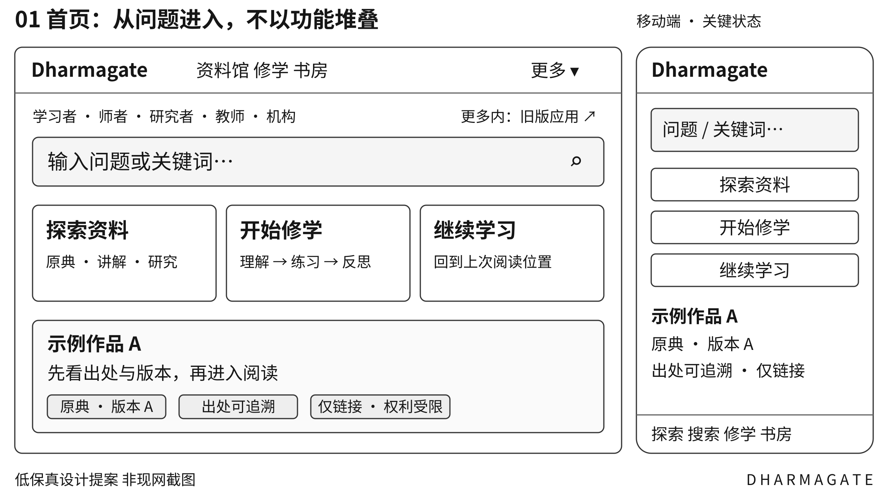
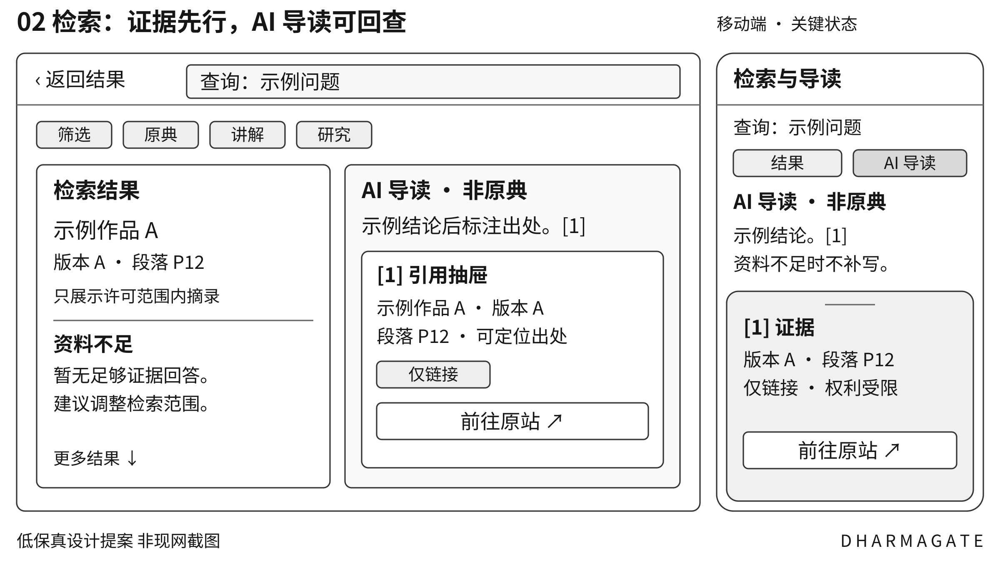
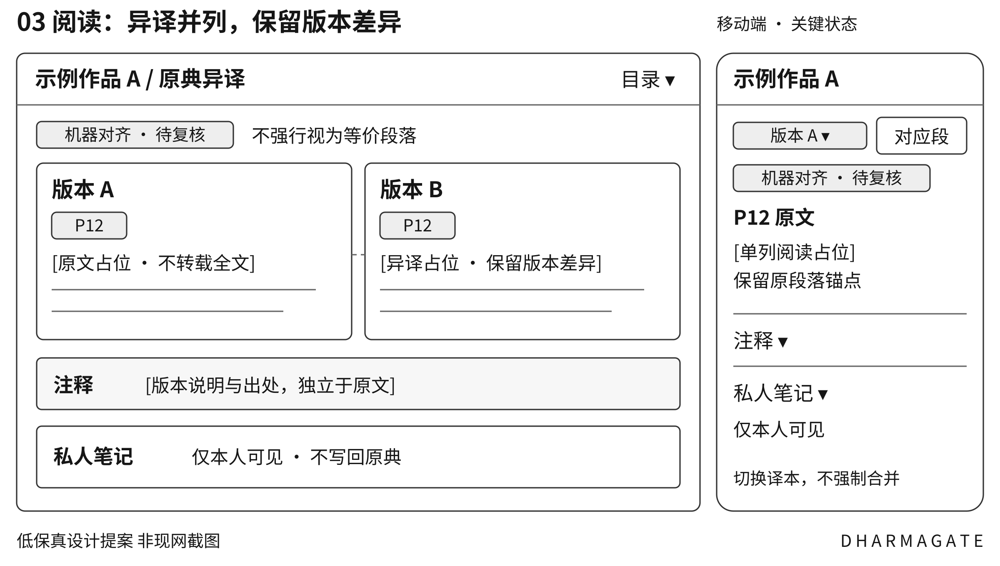
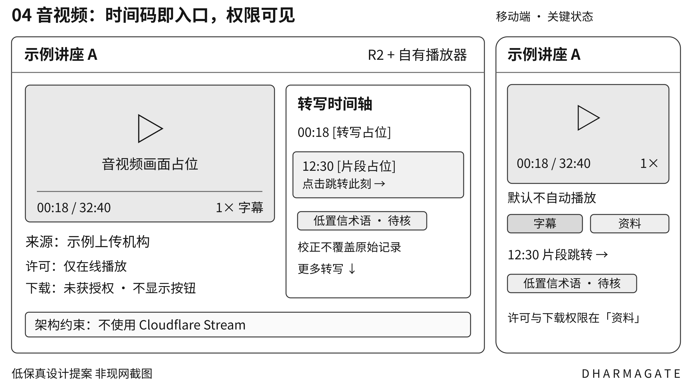
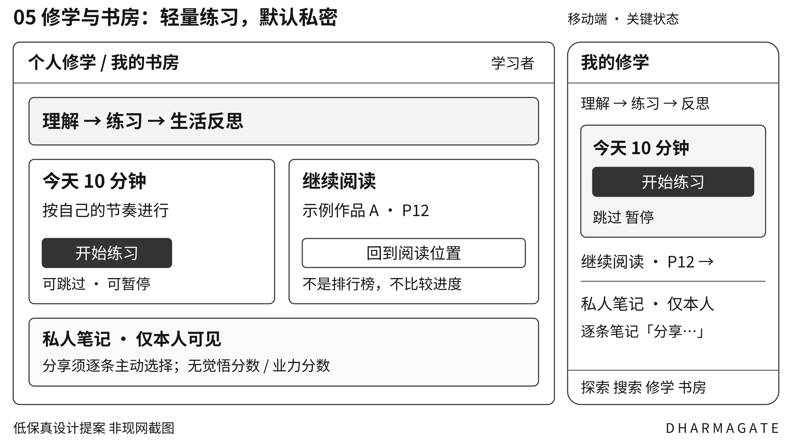
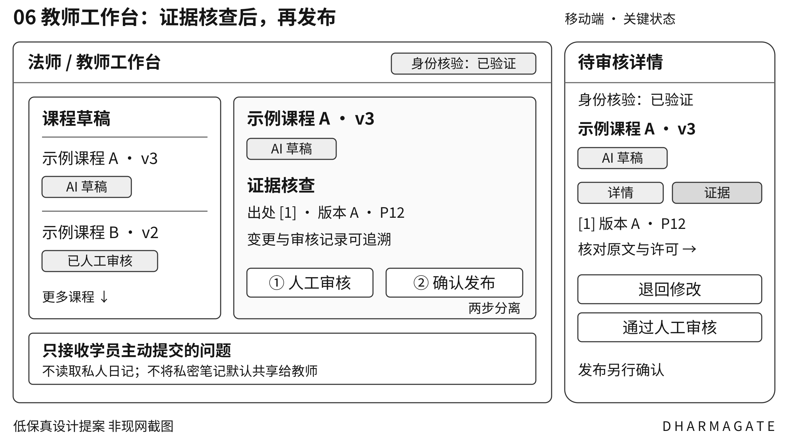

# Dharmagate UIUX体验设计

全球佛学资料与人本修学

设计提案 v0.1 · 2026-10-25

本文是原创设计说明与低保真提案，不是已实现页面或现网截图。

## 01 设计结论与交付边界

Dharmagate 应把全球佛学资料连接成可追溯、可理解、可实践的学习体验。界面先帮助用户找到出处并区分观点，再支持自愿修学与真人指导；不把 AI 包装成法师，不用资料规模、停留时长或打卡次数代表觉悟。

本稿供产品、前后端、内容许可、教研与测试共同实现和评审。所有页面、路由、指标与组件均为**设计提案**，不是现网截图、已开发功能或发布验收。UI 不取代服务端的权限与版权校验。

### 核心任务闭环

遇见问题 → 找到有出处的解释 → 比较资料与观点 → 继续阅读或听讲 → 选择适合的练习 → 私人反思 → 必要时连接真人。每一步允许跳过、返回与退出。

| 层次 | 界面职责 | 明确不做 |
| --- | --- | --- |
| 资料层 | 展示作品、版本、来源、权利与稳定定位 | 不把公开可读等同于可下载或可训练 |
| 理解层 | 区分原典、注疏、研究与 AI 导读 | 不拼接异译为原文，不虚构出处 |
| 修学层 | 提供人工审核路径与自愿记录 | 不设觉悟、业力或宗教身份评分 |
| 真人关系层 | 显示核验状态与审核责任 | 不冒充法师，不默认读取私人日记 |

**P0** 先覆盖一条合法来源与 10–30 部代表资料：目录、检索、证据回答、阅读、私人书签及纠错。**P1** 再验证影音、异译对照、修学路径与法师教师工作台。影音只用 R2＋自有播放器，不使用 Cloudflare Stream。

本文件与产品定义、架构定义配套；实现任务沿用 DG-001 至 DG-045，本文页面采用 UX-01 至 UX-06，组件采用 C-01 至 C-08。既有站点与旧入口必须单独回归，不因新设计而假定迁移成功。

## 02 五类用户与可验证旅程

以下是待验证的角色假设，不是已完成访谈的用户画像。一个人可兼具多种角色；首次访问不要求填写信仰身份，语言、主题与可用时间均可跳过或改选。

| 角色 | 目标与情境 | 主旅程 | 失败风险与设计回应 |
| --- | --- | --- | --- |
| 学习者 | 从生活困惑开始，先读得懂 | 提问 → 看出处 → 阅读 → 短练习 → 私人反思 | 术语过载或被说教；先短答、可展开，不强迫练习 |
| 师者 | 法师或修学指导者审核资料 | 核验身份 → 选教材 → 审草稿 → 发布版本 → 回应主动提问 | AI 冒名、越权读日记；身份与审核分开标记 |
| 研究者 | 精确比较作品与异译 | 筛选版本 → 对照段落 → 看差异 → 导出引用 → 纠错 | 误合并版本；保留版本标识和不确定对齐 |
| 教师 | 兼顾课时与不同教学情境 | 选目标 → 组资料 → 编辑草案 → 审核锁版 → 授课 | 机器改动已审课件；新修改产生新版本 |
| 机构 | 寺院或馆藏单位维护授权资料 | 提交元数据与权利 → 审核 → 发布 → 更新或撤回 | 授权范围被扩大；默认最小权限并留回执 |

### 关键跨角色交接

学习者在“分享这一条笔记”中选择具体对象、用途与期限；师者只能看到被授权的副本。机构只看到自己资料的汇总使用信息，不获得个人修学轨迹。研究者的纠错进入编辑审核，不直接覆盖原典。

### 首次使用与返回体验

首次只问“现在想理解什么”“这次有多少时间”“偏好语言或资料范围”，全部可跳过。返回时优先恢复上次阅读位置；不公开连续学习天数，不用断签或排名制造压力。

### 研究验证

P0 原型先验证找出处、恢复阅读、保存私人笔记、找到旧应用四项任务。后续试点建议覆盖五类角色及低视力、键盘操作用户；DG-039 的 30–50 人为招募建议，不代表已开展研究。

## 03 信息架构与导航规则

导航按用户任务组织，不按云产品或 AI 模型分类。公开浏览与私人书房分开，管理员和教师功能不挤占普通学习者的主导航。

| 空间与层级 | 建议路由 | 可见性与阶段 |
| --- | --- | --- |
| 首页 → 搜索入口与继续学习 | / | 公开；UX-01；P0 |
| 资料馆 → 作品 → 版本 → 段落 | /catalog → /works/:id → /read/:editionId | 公开元数据；正文依授权；UX-03；P0 |
| 搜索 → 资料结果与证据导读 | /search | 公开可用；答案依资料权限；UX-02；P0 |
| 阅读与听讲 → 媒体与时间码 | /media/:id?t=750 | 按资源授权；UX-04；P1 |
| 修学路径 → 单元 → 练习 | /learn → /learn/:pathId | 公开目录；记录登录可用；UX-05；P1 |
| 我的书房 → 书签 笔记 最近阅读 | /library → /notes/:id | 仅本人；最小书房 P0，分享 P1 |
| 法师教师工作台 → 草稿 审核 课程 | /workspace/teaching | 经角色授权；UX-06；P1 |
| 研究工具 → 对照与引用导出 | /research | 公开可用工具；资料依授权；P1 |
| 机构工作台 → 授权 提交 撤回 | /workspace/institution | 机构租户内授权；P1 |

### 桌面与移动导航

桌面主导航为“资料馆、修学、我的书房”，搜索常驻；“更多”含研究工具、工作台、帮助与旧版应用。移动底栏固定“探索、搜索、修学、书房”，工作台在账号菜单中。未开放的 P1 入口隐藏或明确标“尚未开放”，不可呈现空壳可点击入口。

非敏感筛选条件可写入 URL；问题文本通过请求体传递，不进入 URL 或分析日志。返回通过会话状态恢复查询与滚动位置。私人笔记与访问令牌不得进入 URL；引用深链携带作品版本与定位，不以标题作唯一标识。

新旧入口通过已审核路由映射兼容，不在本稿指定或替换旧站真实地址。页内面包屑、浏览器返回、移动返回行为必须一致；对应 DG-002、DG-022、DG-023。

## 04 首页设计 UX 01

目标是在不注册的情况下完成第一次资料发现。主搜索接受问题、经名、人物、主题或原文片段；搜索与继续学习比推广内容优先。

[查看可编辑 SVG](assets/01-home.svg)

*图 1 首页关键区域。示例内容为原创占位；移动端保持同一任务优先级，不照搬桌面多列。*

| 交互 | 实现约束 | 验收点 |
| --- | --- | --- |
| 提交搜索 | Enter 与按钮等效；输入保留，先展示资料结果 | 未登录可找公开资料，不先弹注册 |
| 继续学习 | 仅对登录用户展示本人上次位置；访客展示浏览目录 | 不暴露其他账号或公共设备的记录 |
| 学习入口 | 时间与偏好可跳过，默认不建立敏感画像 | 可返回资料馆，不强迫完成问卷 |
| 资料卡 | 展示类型、语言、来源与权利；不承诺全量收藏 | 仅链接资源按钮为“前往原站” |

**状态与降级：** 首次无记录显示“从资料馆开始”；推荐失败保留搜索与目录。加载使用骨架，不展示虚构条目或虚构数量。旧版入口须可从更多菜单在两次操作内找到。对应 DG-022、DG-024。

## 05 搜索与证据回答 UX 02

资料结果与 AI 导读是两个不同视图。默认先提供可验证结果；导读明确标识“AI 生成，可能有误”，事实性论断链接到支持该论断的具体证据。

[查看可编辑 SVG](assets/02-search.svg)

*图 2 并列示意有证据与资料不足状态，非同一查询的真实结果。引用可回到原段落；不足时不生成确定答案。*

| 交互 | 实现约束 | 验收点 |
| --- | --- | --- |
| 筛选与排序 | 语言、传统、类型、权利、来源可组合；显示已选条件 | 无结果可逐个撤销筛选，不静默扩大范围 |
| 打开引用 [1] | 展示来源、作品、版本、定位、摘录与访问权利 | 打开原段/时间码后能返回同一答案位置 |
| 生成导读 | 仅使用用户可访问证据；原典与机器解释不混排 | 来源失效时该句标待核验，不留下假引用 |
| 纠错与反馈 | 区分误引、错字、许可问题；附版本与片段 ID | 反馈原文不自动公开，可查看处理状态 |

**数据契约：** 前端引用 DTO 使用 canonical_id、edition_id、segment_id、locator，以及独立的 content_version、rights_version；来源保留 source_url、provenance。rights_scope 只是服务端授权后 rights 的展示摘要；segment_id 为稳定证据实体，不是模型临时切片 ID。无充分证据则明确资料不足。对应 DG-017 至 DG-023、DG-025。

## 06 原典异译阅读 UX 03

P0 先完成单版本阅读；P1 扩展异译并排与人工确认对照。作品、版本、译者与来源在正文前可见，读者不会把不同版本的拼接误认成一部原典。

[查看可编辑 SVG](assets/03-reader.svg)

*图 3 异译对照是可检查的关系，不是等价承诺。示例正文为占位，不代表第三方原典内容。*

| 交互 | 实现约束 | 验收点 |
| --- | --- | --- |
| 切换版本 | 保留作品关系；有人工对应则定位，无对应则提示 | 缺段显示“未找到对应段落”，不填造文本 |
| 选段引用 | 引用包含版本、段落或页码；允许复制许可范围内内容 | 导出后仍可定位，引用与私人笔记分储 |
| 注释与 AI 解释 | 原文、注释、机器译文、AI 导读有独立标签 | 关闭辅助层后原典不变，不自动改写原文 |
| 书签与纠错 | 登录后保存本人位置；纠错引用原片段与版本 | 草稿未保存时离开提示，返回不丢输入 |

**移动与状态：** 不强制双列横向滚动，使用“版本 A／版本 B”切换与“看对应段”。字号 18–22 px 可调，正文建议 28–40 汉字行宽。授权撤回时停止正文显示并给出状态说明；不沿用过期缓存。对应 DG-018、DG-023、DG-024、DG-033。

## 07 音视频与时间码 UX 04

本页为 P1。媒体采用 **R2＋自有播放器**，不依赖 Cloudflare Stream。授权、转码与转写是独立能力；播放器不把“文件存在”误标为“内容已全部可检索”。

[查看可编辑 SVG](assets/04-media.svg)

*图 4 播放位置、字幕片段和引文共用时间码。低置信度术语明确待核验，不冒充已校正原话。*

| 交互 | 实现约束 | 验收点 |
| --- | --- | --- |
| 首次播放 | 不自动播放；支持字幕、速度、静音与键盘控制 | 移动端手势启动，播放状态不靠颜色表达 |
| 点时间码 | 定位到片段起点并高亮字幕；保留原语言标识 | 跳转误差建议 ≤2 秒，实测后定门槛 |
| 字幕与搜索 | 无字幕显示“仅标题与简介可搜索” | ASR 草稿不显示人工校正徽标 |
| 下载与分享 | 仅允许范围提供下载；分享应用链接而非私有裸地址 | 权限过期可重新验证，不暴露签名或令牌 |

**故障与恢复：** 缓冲保留播放位置；断网可重试，刷新授权后恢复位置。无转码版本时提供支持格式或原站入口，不声称 R2 自动转码。受限媒体拒绝访问时不显示私有字幕；Range、CORS 与缓存隔离由架构验收。对应 DG-030 至 DG-032。

## 08 个人修学与私人书房 UX 05

P0 的书房只保存书签、位置与简短笔记；P1 的修学路径连接“理解、练习、生活反思”。用户可以暂停、跳过或结束，不以连续打卡施压。

[查看可编辑 SVG](assets/05-study.svg)

*图 5 “仅本人”是可验证权限，不是口号。分享是一条独立、可撤回的操作，不随加入课程自动发生。*

| 交互 | 实现约束 | 验收点 |
| --- | --- | --- |
| 选择路径 | 显示目标、时长、审核者、资料与适用边界 | 未审核内容不得冒用“老师已审核” |
| 练习与反思 | 询问观察和行动，不评价证悟；支持只读不练习 | 不出现业力分数、修行排名或羞辱文案 |
| 保存与同步 | 显示保存中、已保存、失败；本机草稿有明确说明 | 冲突保留两个版本，不静默覆盖 |
| 分享一条笔记 | 确认对象、内容、用途、期限与撤回方式 | 默认不选全书房，不向老师开放其他笔记 |

**边界：** 私人笔记不进入共享 RAG 或共享模型训练。严重困扰不归因于业障、开悟或特殊使命；界面支持暂停修习与寻求合适真人帮助，不提供诊断或高风险练习。导出、删除与授权撤回入口放在书房设置。对应 DG-024、DG-026、DG-035。

## 09 法师教师工作台 UX 06

本页为 P1。师者与教师可共用审核能力，但身份、机构归属与可发布范围分别授权。“已核验身份”不代表每条内容已被审核，更不代表平台认可其一切观点。

[查看可编辑 SVG](assets/06-teacher.svg)

*图 6 AI 草稿、人工审核、已发布为不同状态；内容版本和审核者始终可追溯。*

| 交互 | 实现约束 | 验收点 |
| --- | --- | --- |
| 创建课程草稿 | 选择资料范围、课时与受众；输出标 AI 草稿 | 不得自动以老师第一人称对外发布 |
| 审核与锁版 | 逐项检查出处、适用性与练习边界，记录审核人 | 修改已审文本产生新版本并重新审核 |
| 发布确认 | 确认版本、可见范围、引用权利与变更摘要 | 无权限时服务器拒绝；不得仅灰掉按钮 |
| 学员问题 | 仅显示主动提交或明确授权的内容 | 不展示未分享日记，不跨课程租户泄漏 |

**状态机：** 草稿 → 待审核 → 退回修改或已审核 → 待发布确认 → 已发布 → 已撤回。身份待核验时可保存私人草稿，不展示“认证法师”标识。移动端支持逐项审核，复杂编排建议桌面完成但不阻断阅读。对应 DG-006、DG-034。

## 10 视觉设计令牌与阅读规范

产品采用安静、清晰、非神秘化的视觉语言。不给 AI 使用法师肖像、仿真声音或人格化法号；来源可信度靠可展开证据，不靠金色徽章或权威暗示。以下为可直接映射为 CSS 变量的建议值。

| 令牌 | 建议值 | 使用规则 |
| --- | --- | --- |
| color.canvas / surface | #F7F7F2 / #FFFFFF | 画布与正文背景；不靠纹理承载文字 |
| color.text / muted | #202624 / #52625A | 正文与次级文字；禁止降低到难读灰度 |
| color.primary | #235747 | 主动作底色配白字；链接同时加下划线 |
| color.border / focus | #77867E / #1D4ED8 | 控件边界与 3 px 焦点环；焦点外偏移 2 px |
| color.warning / danger | #7A4300 / #9A2E2E | 白底文字；同时配标签或图标，不只用颜色 |
| font.ui / reading | Noto Sans CJK SC / Noto Serif CJK SC | 系统字体回退；按语种选字形，不强制中文字体覆盖全部文字 |
| type.body / reading | 16 px / 18–22 px | 行高 1.6 / 1.8；字号可调，不锁浏览器缩放 |
| type.label / heading | 14 px / 24–36 px | 说明可到 14 px，关键版权与权限不可藏成微字 |
| space / radius | 4 8 12 16 24 32 48 px / 8 px | 四点基线；卡片圆角不承担状态语义 |
| layout / target | 最大 1280 px / 常用目标 ≥44 px | 阅读最大约 720 px；移动边距 16 px，桌面 24–40 px |
| motion / elevation | 120–180 ms / 0 或轻阴影 | 尊重减少动态偏好；抽屉不闪烁，不自动滚动长文 |

### 内容排版与国际化

中文正文不强制两端拉伸；原文允许保留原标点与换行。界面语言、内容语言、译文语言分别存储；语言菜单使用本族语名称。预留英文扩展和长标题换行空间；未来右到左语言须单独验收，不能宣称当前全语种适配。

静态令牌计算：白底正文对比度 15.39:1、次级字 6.45:1、主色白字 8.31:1、控件边界 3.82:1。仍须在真实状态中复查。目标为 WCAG 2.2 AA，不是已获得合规认证。

## 11 组件契约与空错状态

组件使用真实数据状态驱动，不通过“看起来禁用”代替权限。状态名与文案集中管理，日志记录错误代码而非私人内容；错误消息给用户可采取的下一步。

| 组件 | 必要属性与交互 | 关键状态 |
| --- | --- | --- |
| C-01 搜索框 | label、query、scope、submit；保留输入 | idle / loading / success / empty / error |
| C-02 资料卡 | type、title、edition、source、rights；标题为主链接 | 可读 / 仅链接 / 受限 / 已撤回 |
| C-03 证据抽屉 | answerId、citationId、locator；打开后聚焦标题 | 已验证 / 待核验 / 不支持该句 / 失效 |
| C-04 版本切换器 | editionId、语言、对应关系；切换不拼接正文 | 已对齐 / 机器对齐 / 缺段 / 无权限 |
| C-05 媒体控制 | position、duration、caption、permission；可键盘操作 | 未播放 / 缓冲 / 播放 / 暂停 / 错误 |
| C-06 私人编辑器 | noteId、revision、saveState；保护未保存输入 | 本机草稿 / 保存中 / 已保存 / 冲突 |
| C-07 权利与审核标记 | rights、status、reviewer、内容/权利版本；可展开解释 | 仅元数据 / 仅链接 / 授权全文；AI 或人工 |
| C-08 确认对话框 | 对象、范围、后果、取消；明确主次按钮 | 待确认 / 执行中 / 成功 / 可重试失败 |

| 场景 | 推荐文案 | 恢复动作 |
| --- | --- | --- |
| 无结果 | 没有找到符合这些条件的资料 | 移除某个筛选或修改关键词；不改写用户问题 |
| AI 不足 | 当前资料不足以支持这个结论 | 查看已有证据、缩小问题；不造答案 |
| 无权限或过期 | 这项内容当前不可访问 | 重新登录或查看公开目录；不暴露私有标题 |
| 断网与保存失败 | 尚未同步，你的输入仍在本机 | 重试或复制草稿；清楚说明本机保存边界 |
| 限额或服务故障 | 暂时无法生成导读，资料检索仍可使用 | 继续阅读、稍后重试；不无限自动重试 |

基础控件统一 default、hover、focus、pressed、disabled、loading 六态。主按钮每个任务区至多一个；次按钮用描边，危险动作使用明确动词与再次确认。禁用须给原因，不只降透明度；加载中保留按钮宽度，屏蔽重复提交。

表单标签常驻，不以占位符替代。错误紧邻字段并说明改法，提交失败聚焦首个错误；保留用户已填内容。加载可显示骨架，超时给取消或重试。成功消息用状态区域播报，不抢焦点；删除前展示精确对象与后果。

## 12 隐私版权与审核标记

资料权利、内容性质、审核状态是三个独立维度，不压成一个“可信”徽标。每个标记可展开解释来源与作用范围；缺记录时默认限制，不从页面可访问推导额外许可。

| 维度 | 可见标签 | 按钮与行为 |
| --- | --- | --- |
| 访问与使用权利 | 仅元数据／仅链接／授权全文／受限／已撤回 | 分别显示查看目录、前往原站、阅读；下载另按许可 |
| 内容性质 | 原典／注疏／研究／机器转写／AI 导读 | 始终贴近内容标题，复制时保留性质说明 |
| 身份与审核 | 身份待核验／身份已核验；AI 草稿／人工已审核 | 分别显示核验范围、审核人、版本和时间 |
| 个人可见性 | 仅本人／已分享给指定对象／授权已撤回 | 编辑器旁常驻；共享前后有明确状态回执 |

### 最小权限矩阵

| 对象 | 本人 | 老师或机构 | 公开与共享 AI |
| --- | --- | --- | --- |
| 私人笔记与阅读位置 | 可读写 导出 删除 | 默认不可读；仅按单项授权读取 | 不公开，不进入共享 RAG 或模型训练 |
| 主动提交的课程问题 | 可查看与撤回授权 | 指定课程授权者可读；处理须有边界 | 默认不公开，不自动转作语料 |
| 授权资料 | 按该资源许可访问 | 按租户角色与权利处理 | 仅经权利闸门可索引、摘录或展示 |
| 机构统计 | 仅相关个人自己的记录 | 仅最小必要聚合，避免小样本反识别 | 不公开个人宗教身份或修学轨迹 |

**分享确认内容：** 精确笔记或摘录、接收对象、用途、有效期、是否允许下载，以及撤回后已导出副本无法保证收回。不要用默认全选或捆绑同意扩大范围。

**撤回与外部处理：** 权利撤回后新请求立即阻断，并传播到引用、索引、缓存与衍生物。调用外部模型前说明传输范围并最小化内容；不能仅凭“生成”按钮视为无限授权。界面不显示内部令牌或私有对象地址。对应 DG-009、DG-011、DG-026、DG-038。

## 13 响应式与可访问性验收

目标是同一任务在桌面、移动、键盘与辅助技术下均可完成。下列为设计与测试要求；须在真实实现中逐项验证，不以线框或自动扫描宣称通过。

| 断点建议 | 布局行为 | 不允许的退化 |
| --- | --- | --- |
| <768 px | 单列；底栏四入口；筛选和引用用抽屉；阅读版本切换 | 正文水平溢出、把核心权限文案折叠消失 |
| 768–1199 px | 双区按内容决定；侧栏可收起；阅读可选对照 | 强行挤成三栏，依赖悬停才能操作 |
| ≥1200 px | 最大 1280 px；结果与证据并列；留阅读行宽 | 整屏超长文本行或无限放大卡片 |

### 必须覆盖的测试

**键盘与焦点：** 跳转主内容、导航、筛选、播放、保存均可无鼠标完成。焦点清晰且不被固定栏遮挡；模态抽屉内循环 Tab，Escape 关闭，返回触发控件。非模态侧栏不捕获焦点。[S2]

**视觉与重排：** 普通文字对比度至少 4.5:1，大字及关键非文本控件按 3:1 检查。200% 文本缩放与 320 CSS px 窄视口下不丢信息；正文无需双向滚动。目标 AA 的完整范围仍须按标准评审。[S1]

**触控与动态：** 项目默认常用控件至少 44×44 CSS px；这高于 WCAG 2.2 AA 的 24×24 最小目标或间距例外要求。不要把 44 px 误写为 AA 硬性门槛。尊重减少动态设置。[S3]

**语义与媒体：** 标题层级、表头、标签、错误关联、状态播报可由读屏识别；图标有可访问名称。音视频提供授权范围内字幕或转写，并按内容需要提供替代说明；不自动播放。登录允许粘贴与密码管理器，不增加无替代方式的认知测试。

[[S1] W3C WCAG 2.2 正式规范 访问日期 2026-10-25](https://www.w3.org/TR/WCAG22/)

[[S2] W3C ARIA 模态对话框模式 访问日期 2026-10-25](https://www.w3.org/WAI/ARIA/apg/patterns/dialog-modal/)

[[S3] W3C 最小目标尺寸说明 访问日期 2026-10-25](https://www.w3.org/WAI/WCAG22/Understanding/target-size-minimum.html)

## 14 开发交接与验收清单

实现前先对账既有成果；设计页面不等于新的独立应用，也不要求重建全部旧站。产品确认范围，设计交互复核，内容团队确认来源与许可，工程实现权限与状态，测试提供实际回执。

| 任务 | 关联 backlog | 建议通过条件 |
| --- | --- | --- |
| 找资料并打开出处 | DG-017 至 DG-023 | 用户从问题进入资料，能区分 AI 与原典并定位同一版本片段 |
| 继续阅读并存笔记 | DG-024、DG-026 | 跨设备恢复；他人账户无法读取笔记；失败不静默丢输入 |
| 报告误引或权利问题 | DG-025、DG-038 | 携带原版本与片段，状态可追踪；撤回后新请求被阻断 |
| 打开旧版应用 | DG-001 至 DG-004 | 旧入口兼容、关键路由回归通过，有发布与回退回执 |
| P1 时间码与对照 | DG-030 至 DG-033 | 播放、字幕、时间码一致；缺段与机器对齐标签正确 |
| P1 审核与修学 | DG-034、DG-035 | 草稿不能绕过审核发布；学习者可退出且私人日记不外泄 |

### 任务测试与阻塞项

建议以未受训练的目标用户验证四项 P0 任务，目标任务成功率 ≥90%；记录失败路径，不把样本结果外推为全体用户。预发布引用定位目标 ≥99%，人工抽检支持性目标 ≥95%，与 DG-021 共用评测集。以上均为建议门槛，不是实测成绩。

**任何一项即阻塞上线：** 跨账户或跨机构泄漏、虚构出处、失效权利仍可访问、AI 冒充真人审核、不可恢复的数据丢失、旧核心入口回归失败。不能用平均得分掩盖这些问题。

### 交付与待确认决策

交付含本设计说明、6 个桌面与移动组合线框的 SVG／PNG、可编辑 Word 与 PDF。SVG 是设计资产，PNG 用于文档与 GitHub 预览；不含第三方全文、私人笔记或内部配置。

开发前待确认：首批资料与语言、身份核验责任方、各权利标签映射、对齐与字幕的人工审核规则、笔记保留与删除政策、旧路由清单。功能上线须走 DG-028 的真实验收与批准流程。

依据：同项目产品定义、架构定义、45 项 backlog 与人本体验治理说明；外部可访问性依据见第 13 节。当前版本 v0.1，2026 年 10 月 25 日。

## 配套文档

- [产品定义](product-definition.zh-CN.md)
- [架构定义](architecture-definition.zh-CN.md)
- [实施任务与验收](backlog.md)
